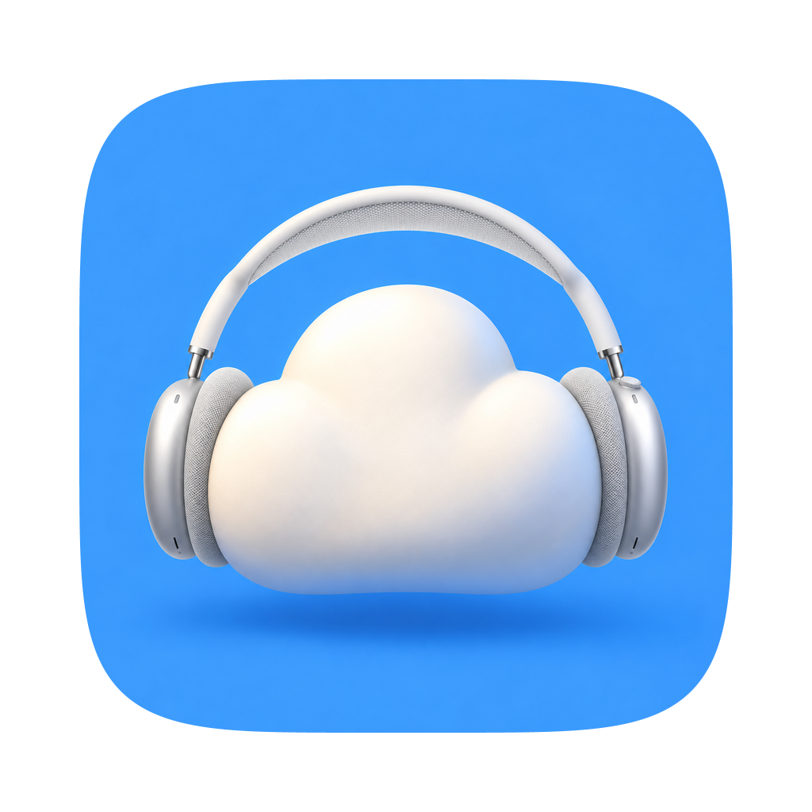

# LofiDesk



在 Mac 桌面播放 Lofi 直播，用菜单栏控制音乐、画面与频道。

**[下载最新版](https://github.com/Michael-IT001/LofiDesk/releases/latest)** · [版本记录](RELEASE_NOTES.md) · [隐私说明](PRIVACY.md) · [使用帮助](SUPPORT.md)

LofiDesk 主体应用为闭源软件。这个公开仓库用于发布安装包、使用说明和版本记录，不公开主体应用源码。

## 功能

- 桌面直播画面：等比铺满主屏幕，鼠标操作可穿透到桌面。
- 菜单栏控制：切换频道、播放与暂停、调节应用音量、静音和退出。
- Lofi Girl 与 Claude FM 频道库，支持搜索、频道排序，以及中文译名与英文原名切换。
- 自动、720p 和 1080p 画质选项；实际可用画质取决于直播源。
- 回看进度条与“回到直播”；可回看的范围由当前直播源提供。
- 关闭“显示桌面画面”后可继续听音频。
- 记住上次成功播放的频道和常用设置，可选择登录时自动启动。

直播内容、频道在线状态、清晰度与回看范围可能变化。LofiDesk 不保证固定频道数量、固定回看时长或所有网络环境下的播放效果。

## 系统要求

| 项目 | 要求 |
|---|---|
| 系统 | macOS 13 或更高版本 |
| 处理器 | Intel 或 Apple 芯片；同一个 Universal 安装包包含 x86_64 与 arm64 |
| 网络 | 能访问 YouTube 及其媒体服务的网络 |
| 额外工具 | 基本播放无需自行安装 Homebrew、yt-dlp 或 Node.js |

当前版本在 Intel Mac / macOS 13.7.8 完成了实际 1080p 播放验证。Apple 芯片版本已完成构建、架构和最低系统检查，尚未完成 M 系列 Mac 实机播放验收。

## 下载安装

1. 进入 [Releases](https://github.com/Michael-IT001/LofiDesk/releases/latest)，下载发布附件中的 `.dmg` 安装包。
2. 打开 DMG，将 **LofiDesk** 拖到 **Applications / 应用程序**。
3. 推出磁盘镜像，从“应用程序”打开 LofiDesk。
4. 在屏幕顶部菜单栏找到云朵耳机图标，打开控制面板。

本次发布文件名为 `LofiDesk-1.0.0-macOS-universal.dmg`。如需验证下载完整性，把同一发布页的 `SHA256SUMS.txt` 与 DMG 放到同一文件夹，在该文件夹打开终端运行：

```sh
shasum -a 256 -c SHA256SUMS.txt
```

结果应显示安装包文件名及 `OK`。校验值不能替代 Apple 公证。

GitHub 自动生成的 **Source code (zip)** 与 **Source code (tar.gz)** 只是这个公开分发仓库的文件快照，不是应用安装包，也不是 LofiDesk 主体源码。

### 首次打开

当前安装包使用本地 ad-hoc 签名，**尚未经过 Apple Developer ID 签名及公证**。首次打开时，macOS 可能提示无法验证开发者。

先确认文件来自本仓库，并核对发布页提供的 SHA-256 校验值。如果你决定信任并打开它，可在尝试打开后，前往“系统设置 → 隐私与安全性”，找到对应提示并选择“仍要打开”，再按系统提示确认。不同 macOS 版本的文字可能略有差异。参见 [Apple 官方打开说明](https://support.apple.com/zh-cn/102445)。

如果系统明确提示软件有害或文件已损坏，请停止操作、重新核对下载，并通过 [使用帮助](SUPPORT.md) 反馈；不要关闭系统安全保护。

## 日常使用

首次启动会尝试播放默认频道，加载速度取决于网络与直播源。你可以从菜单栏进行以下操作：

- 展开频道库，搜索并选择要播放的频道。
- 调整音量或静音。这只影响 LofiDesk，不修改系统音量。
- 使用回看进度条定位；落后直播时点击“回到直播”。部分直播的回看窗口很短或不可用。
- 关闭“显示桌面画面”切换到纯音频，再打开即可恢复画面。
- 在“更多设置”中选择频道名称语言、登录时自动启动，或重新连接当前频道。
- 选择“退出”停止播放并移除桌面画面。系统休眠后可从面板手动恢复播放。

“借用 Chrome 登录”为可选功能，默认关闭。只有明确授权后，应用才会读取 Chrome 默认用户中 YouTube 的登录 Cookie，在内存中用于连接直播；该功能可能需要本机另有可用的 Python 版 yt-dlp。基本播放不以开启它为前提。详情见 [隐私说明](PRIVACY.md)。

## 更新与反馈

更新前先从菜单栏退出旧版，再将新版本拖到“应用程序”并按系统提示替换。版本变化见 [RELEASE_NOTES.md](RELEASE_NOTES.md)。

无法打开、没有声音、频道连接失败或回看不可用时，请先查看 [SUPPORT.md](SUPPORT.md)。反馈时请提供应用版本、macOS 版本、处理器类型和复现步骤，不要公开 Cookie、登录凭据或带签名的播放地址。

## 版权与第三方组件

© 2026 Michael-IT001。LofiDesk 主体应用保留所有权利；仓库公开和安装包可下载，不表示主体源码已开放或授予开源许可。

安装包包含运行所需的辅助脚本和独立第三方工具。第三方组件依各自许可证分发，其权利和义务不受 LofiDesk 主体闭源状态影响；详见 [第三方声明](THIRD_PARTY_NOTICES.md) 和 [对应源码获取指引](SOURCES.md)。

YouTube、Lofi Girl、Claude FM 及相关品牌标志、直播画面和音乐属于各自权利人。LofiDesk 为独立项目，不代表这些服务的官方产品、合作关系或背书。请遵守内容提供方的适用条款与版权要求。
